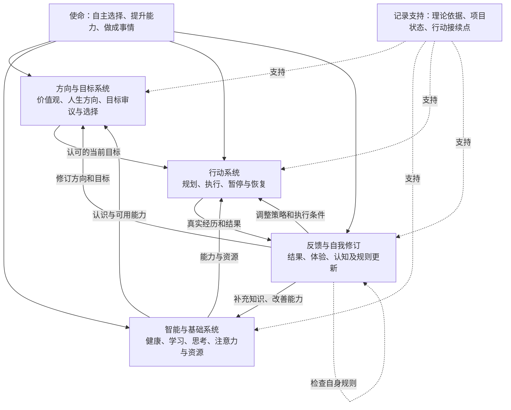
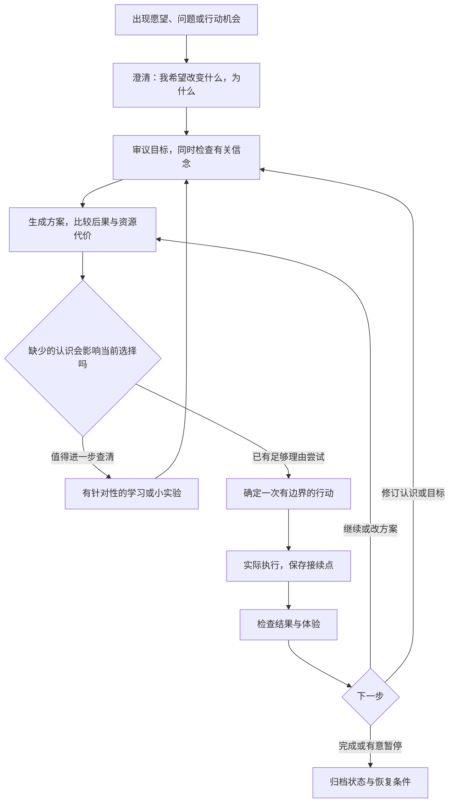

# 人生飞轮：方法论与架构 v0.1

形成日期：2026-10-24。状态：基于需求讨论与《机器人叛乱》部分章节形成的设计初稿，尚未通过生活实践验证。不是全书总结，也不是最终软件架构。

## 使命与成功标准

把自己理解为能够学习、行动并修订自身的智能系统。飞轮帮助我：

1. 选择自己经过反思认可的目标。
2. 提升实现目标的能力。
3. 实际推进和实现目标。

长期目的：知道自己为什么而活，并按认可的方向生活，逐步成为自己满意的人。体验、健康、时间自主及以喜欢的方式创造价值，是目前表达的方向，可以修订。生活体验、休息、关系和开放探索也有价值，不必全部转换为短期交付。

## 如何阅读本稿

- 用户需求：使命、健康/学习/思考/注意力基础、持续投入、中断恢复、项目安心暂停、做成事情。
- 理论依据：见[理论规则与判断线索](理论规则与判断线索.md)的S01—S30及原文定位。
- 本稿的模块划分、流程、行动卡与启动条件均是结合上述材料提出的设计，尚待用户审阅与实践检验。
- 规则是审查依据，不能自动代替选择；高阶欲望不自动优先，内部一致不保证正确，允许暂时未决。

## 一、系统结构：由什么组成



结构表达职责，而非要求四个系统分别实现成软件。反馈跨越所有部分；记录可先用Markdown承担。

| 系统/职责 | 需要回答 | 最小输出 | 依据与成熟度 |
|---|---|---|---|
| 方向与目标：价值审议 | 我在乎什么？这个欲望是否值得认可？ | 暂定目标、理由、冲突及未决事项 | 用户使命；S01—S11、S16—S19；有理论起点，评价方法仍需完善 |
| 智能基础：信念与知识 | 我认为情况怎样？依据可靠吗？ | 已知、假设、不确定性、待查问题 | S12—S17、S19；有起点，具体查证方法待补 |
| 智能基础：思考与求解 | 有什么方案？后果与成本如何？ | 候选方案及暂定选择 | S26—S29；有起点，概率与价值比较待细化 |
| 智能基础：学习与能力建设 | 哪个能力缺口阻碍推进？如何知道学会了？ | 与当前需要相关的学习行动和验证方式 | 用户需求；书中“心智套件”等线索，完整学习理论待补 |
| 智能基础：健康 | 当前身体状态和基本保障是否支持生活与行动？ | 必要维护、限制与后续处理事项 | 用户需求及S16；具体健康方案未建立 |
| 智能基础：注意力与资源 | 当前重点是什么？有多少时间、精力和资金可用？ | 一个当前重点、投入边界及暂停列表 | 用户需求、S23—S24、S27—S29；具体分配规则待验证 |
| 行动：规划与持续执行 | 下一步做什么？怎样开始、完成或恢复？ | 行动、观察结果、接续点 | 用户需求；S20—S24；提示、习惯和恢复机制待补 |
| 反馈与自我修订 | 结果与期待相符吗？应该改哪一处？ | 保留/调整/暂停的决定及下一步 | 用户已确认的循环；S07、S15、S25、S30；回顾办法待验证 |

健康、学习、思考既可能支撑其他目标，也可能本身是认可的生活实践。时间和资金的具体安排仍需协商，不在本稿预设优先级。

## 二、运行过程：一次事情怎样推进



流程可以从中间进入，不必每次重新审议人生；遇到目标不认同、依据薄弱、反复偏离、明显代价或情境变化时，再展开较深检查。此启动策略是待验证的轻量设计。

每一步的最小做法：

1. **澄清**：说清楚当前问题、想要的变化及其价值。长期探索可用当前问题与阶段收获表达，不强求最终终点。
2. **审议**：区分“我认为”与“我希望”。对相关疑点引用规则编号，不机械遍历全部30条。
3. **求解**：比较几个可行行动的可能结果、代价和关键假设。信息不足就标明，不虚构精确概率或单一收益分数。
4. **转换**：问“再研究一小时，可能改变我的哪个决定？”若学习本身是当前认可的体验或能力目标，也应如实说明；既不因不确定永不行动，也不因追求产出草率停止必要查证。
5. **行动**：选一个可开始的动作，约定投入边界及本次结束条件。需要与家人协调的时间先商量。
6. **接续**：结束或中断时，留下位置、当前问题、下一动作；长时间暂停再加恢复条件。
7. **回顾**：检查做到了什么、体验怎样、预期哪里不符。可以改目标、改信念、改方案或改执行条件，不自动归罪于自己不努力。

## 三、一张行动卡即可开始

以下是待验证模板，可删减；不是新增一套必须填完的作业。

```text
项目 / 当前状态：
这次想推进的问题：
为什么值得现在做：
已知与关键假设：
相关规则或未决冲突（如有）：
本次行动 / 投入边界 / 结束条件：
中断或结束时：
  停在哪里：
  正在考虑什么：
  下一步第一个动作：
结果与体验 / 下一步决定：
若暂停：保留材料位置 / 何时或何种条件下重新检查：
```

## 四、用当前飞轮项目走一次

以下是桌面演示，不表示已经完成生活验证。

- 当前问题：阅读所得规则能否组成一套支持选择、行动和恢复的方法？
- 认可理由：用户希望减少混乱、持续研究却没有完成的情况，形成做成事情的方法论。
- 已知：需求与S01—S30已经记录。假设：上述四类职责足以构成首轮试用的骨架，尚未证实。
- 本次行动：整理v0.1、结构图、流程及模板。结束条件：文档可查看，理论依据和缺口可追踪，下一步可明确。
- 当前产物：本稿；项目推进图的接续更新。这是文档成果，不等于方法已经有效。
- 下一步建议：用一件用户选定的真实事情试填行动卡，完成一次行动，并至少根据一次中断恢复或回顾修订方法。
- 暂不预设以教学、赚钱或健康作为试点；这些都由用户选择。

## 五、缺口和后续计划

| 尚缺内容 | 当前处理 | 后续方向 |
|---|---|---|
| 多价值怎样权衡、什么算足够 | 保留具体理由、冲突和例外，允许暂定 | 继续理论阅读并结合真实选择检验 |
| 行为怎样启动并持续 | 先用低负担行动和接续记录试用 | 用户指定福格行为模型为下一本阅读候选，尚未核对原书 |
| 多项目优先级、时间边界、恢复 | 一个当前重点，其他项目保存状态 | 根据使用经历补方法与必要工具 |
| 学习与能力提升 | 指明能力缺口和验证问题 | 后续补学习理论，不要求先设计完整阅读理论 |
| 身体与财务基本保障 | 单独保留事项与约束 | 后续形成具体计划，不把当前局部估算视为完整保障 |

下一阶段建议：审阅v0.1 → 选一个真实案例 → 留下一次实际行动、接续与反馈记录 → 修订v0.2。软件需求在其中继续提炼。

## 六、怎样判断首轮试用有没有帮助

- 能否解释为什么选择当前事情，并接受暂时没做其他事情的取舍？
- 能否分清还需要了解什么，与现在就能尝试什么？
- 是否实际推进了一步，或获得了能改变后续选择的新认识？
- 中断或间隔后，能否依据记录接上？
- 方法是否让生活更清楚、符合认可，记录成本是否可以接受？

一个案例只能提供局部证据。方法本身接受S19所要求的评估：没有帮助时检查它，不要求用户先无条件相信。
