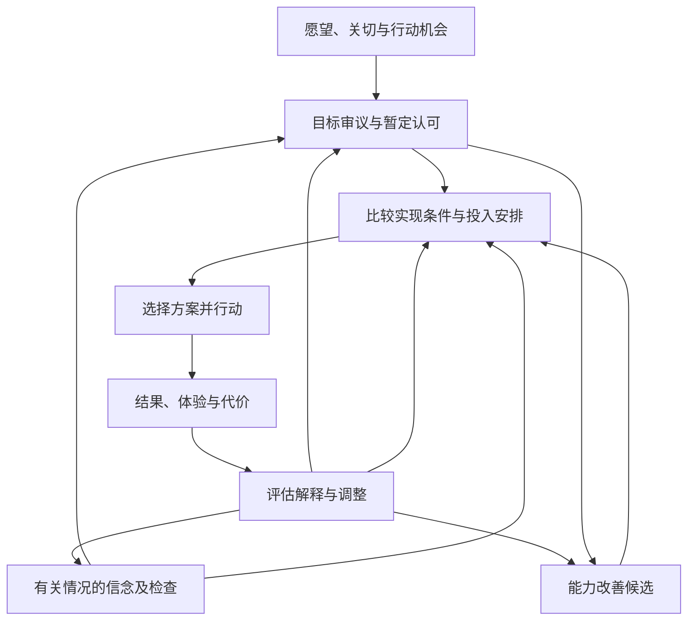

# 人生飞轮逐步推导 01：从愿望到投入，再到行动与修订

形成日期：2026-10-25。最近审阅更新：2026-10-28。

本文承接这次对话。用户出门前授权助手继续逐步推理并记录，方便回来后逐步跟上。**授权继续推理，不等于确认推理结果。** R01—R12最初均为助手草稿；现按各步审阅状态分别登记确认范围。R01、R02核心区分、R03可修订方向、R04评价本身接受评价，以及R05用规则引导具体审议的用法已获确认；其余内容见下方标记，没有新增实践验证结论。

## 回来从这里读

首次阅读可先读下方“已确认的出发点”，再从R01开始。R05规则用法已获确认，当前接续第一条具体线索：身体及长期行动能力的影响；可以一次只讨论一项。若某一步有问题，后面依赖它的推论也需要重查。每步末尾的问题用于定位分歧，无须逐项填表。

| 阅读段落 | 这段只解决什么 | 暂时不解决什么 |
|---|---|---|
| R01—R04 | 分清愿望、目标、事实判断与认可理由，处理初步冲突 | 最终价值理论、完整人生规划 |
| R05—R08 | 检查理由，比较当下投入，处理可行性与信息缺口 | 通用的价值打分公式、确定的人生优先级 |
| R09—R12 | 把投入接到行动、恢复、评估与能力改善 | 完整通用智能构成、脑机制与软件架构 |

**当前共同接续点（2026-10-28）：**R05的规则用法已获用户认可，用户将其概括为“大框架”，并补充AI辅助下由用户作最终决定的意思（原句用“排版”，按语境暂解为“拍板”，保留纠正空间）。当前接续第一条具体线索：目标对身体及长期行动能力的影响。四条具体线索及冲突处理程序仍待逐项确认，不直接接到R12。

## 已确认的出发点

依据[需求探索记录](需求探索记录.md)2026-10-25接续摘要，以下内容已有用户明确表达或确认：

| 编号 | 已确认内容 | 确认的范围 |
|---|---|---|
| U01 | 以智能为主要研究视角，暂以实现复杂目标的能力理解智能，把人看成一种通用智能来研究 | 是当前建模假设；不是已经核实的完整主体理论 |
| U02 | 飞轮包括挖掘、审议和选择目标，以及实现所选目标 | 具体价值评价办法与实现机制仍待研究 |
| U03 | 实现目标、改善实现目标的能力，都是飞轮的一部分 | 不代表已确认一套完整的功能或部件清单 |
| U04 | 能力改善可服务具体目标，也可因其本身被认可有价值而成为目标 | 未选定个人当前应改善哪种能力 |
| U05 | 需要评估目标实现过程，判断困难在哪里、应该改变什么 | 确认评估与调整职责；方法和机制未定 |
| U06 | 飞轮区分一般理论和具体个人实践 | 理论的适用范围仍须论证与验证 |
| U07 | 需要研究愿望或价值认同怎样成为主体决定投入的目标 | 确认研究问题；不是对后文程序的认可 |

内容约束：尊重长期探索、体验、家庭和健康的价值；不要求全部活动服务短期交付。本文举例均为解释思路的假设情境，不是替用户选目标或安排日程。

## 材料与推理的边界

- 《机器人叛乱》两份本地Markdown可读。本轮回查了“理性意味着什么”“让你的工具理性更充实”“什么样的模因对我们友善”及高阶偏好冲突的相关文字，原文指纹与[项目依赖清单](项目依赖清单.md)一致。引用是对书中观点的释义，没有独立核验其当代科学有效性。
- 原书图3-1、图3-2的图片缺失。本轮能读取作者对信念、欲望及行为决定关系的文字说明，不能声称核对过图像细节。
- 按本地文件名仍未找到《生命3.0》原书。此前找到的作者公开节选只作局部线索；本文不扩展论证生命阶段、智能跨越点或任意目标实现能力。
- 尚未核对邦格相关原文，不把下文功能划分称为邦格的系统模型。
- 福格行为模型仍为后续阅读候选，不用于证明这里的行动、记录或习惯设计。

文中“依据”指已确认前提或[理论规则与判断线索](理论规则与判断线索.md)中的编号。**从依据走到某个具体做法的那一步，仍是助手的推论。**

## R01：先分清“想要”“认可”与“决定投入”

**审阅状态（2026-10-27）：核心区分已确认。**用户先表述“想要是欲望，欲望可以被评价”，随后确认“认可”与“决定投入”的区别。共同明确：欲望表达想要什么；认可表达对追求它的赞同评价；决定投入表达结合当前条件作出的具体资源安排。可以保留对目标的认可，同时暂不投入。该确认不连带确认本节关于状态A/B或目标持续形式的其他扩展，也不表示具体评价与投入方法已经建立。

**起点：**U02、U07。我们要研究从愿望走向投入，中间发生什么。

**推理：**考虑三句话：“我想提高思考能力”“我认为提高思考能力值得”“我准备把这段时间用于改善它”。第一句表达愿望，第二句表达评价，第三句涉及实际投入安排。三者可能同时出现，也可能暂时分离。把它们合写成一个“目标”，会遮住尚未完成的判断。

**暂定结论：**讨论时先区分愿望、认可理由、投入决定。这里采用的是便于分析的用语，不要求所有人都这样定义目标，也不假定心理过程按固定顺序发生。

希望实现的东西可以是一个结果、一种持续状态或一类生活实践。因此，“状态A到状态B”也可表达维持、发展和探索；暂不要求为每个目标设一个最终完成点。

**回来可检查：**这三个表达是否区分了你关心的问题？若你使用“目标”时指其中不同部分，我们应先统一用词。

## R02：目标判断同时涉及“我相信什么”与“我在乎什么”

**审阅状态（2026-10-27）：核心区分已确认。**用户明确认可，概括为“目标有价值评价和事实评价”。本项目据此分别检查：关于目标的效果、实现条件等事实判断是否有支持，以及追求目标的价值理由是否得到认可。这里把“两类评价”作为共同讨论用语，不把目标本身当作有真假的事实命题；具体标准、方法及本节关于状态A的建模扩展仍未确认。

**起点：**R01的核心区分已获确认；事实评价与价值评价的区分现也获确认，以下保留原推导及其范围。

**推理：**“提高思考能力会让我更能解决问题，所以我愿意练习”中，前半句包含关于能力与结果的判断，需要证据；后半句还依赖“我在乎解决这些问题”这一理由。若能力增长本身使人满意，则另有U04所确认的认可理由。

**暂定结论：**先分别表达当前相信的情况、希望出现的变化，以及在乎它的理由。当前状态A只需描述与这个问题相关的条件，并标明哪些是已知、估计和未知；不必先完成对自己的全面建模。

依据S11、S13、S17，以及原书“让你的工具理性更充实”对信念和欲望的区分。把它转成上述表达方式是本项目设计。事实判断和价值认可相互影响，不据此推成互不相关的两个封闭系统。

**回来可检查：**有没有某个被称作“价值观”的要求，其实依赖一个尚未查清的事实判断？这里只提出检查方向，不预判具体要求有错。

## R03：评价依据尚不完整时，可以先说明暂借哪些理由

**审阅状态（2026-10-27）：保留积累和修订空间的方向已确认。**用户表达认可，认为“评价依据是后天积累的，我们可以留下空间”。将前半句记录为用户当前对评价依据发展的理解，后半句作为保留发展及修订空间的明确确认；不据此宣称已独立核实所有评价依据的形成机制，也不把本节全部操作细节标记为确认。

**起点：**用户正在寻找评价方法，不能要求用户先提供一套成熟价值观，才能开始审议。

**推理：**若每个判断都要等完整价值理论先完成，当前选择就会一直悬置。相反，只凭“我现在这么想”直接结束讨论，也没有完成所要求的审议。中间可以尝试：列出目前能表达的理由，检查它们依赖的事实、后果和相互关系，并标明哪些还不稳。

**暂定结论：**先作有理由、可修订的暂定认可，同时保留未解决的问题。体验、关切、承诺和现有价值判断都可进入讨论；这里只把它们当作可以检查的材料，没有证明哪一种是最终依据。

依据S07、S15的可修正评估方向。它们支持继续检查暂借的前提，不能提供绝对正确的价值起点，也不能把内部一致当作真理保证。

**回来可检查：**这种“暂借理由、允许重查”的办法是否足以支持继续推理？它还缺哪些约束，正是后续问题。

## R04：出现冲突时，需要比较内容和理由

**审阅状态（2026-10-28）：评价本身接受评价已确认。**用户明确认可“对欲望的评价本身，也应当接受评价”。确认范围是自我要求及评价理由也可被审议；本节关于不同冲突的全部处理办法、评价停止条件及具体权衡程序仍未确定。

**起点：**R03中为评价依据保留发展和修订空间的方向已确认；以下如何处理理由冲突的分析仍待检查。

**推理：**例如，想继续研究与想和家人相处，可能争用同一段时间。把其中一项称为“更高的追求”，并没有说明它为什么在此刻应胜出；把另一项称为“当下的喜欢”，也没有说明它应被放弃。我们还需要检查实际冲突、各自的理由，以及是否存在减少冲突的安排。

**暂定结论：**先说明冲突在哪里，再比较理由与可选安排；必要时保留部分未决。不能仅凭欲望层次、来源或表达得更宏大来判定优先。

依据S01、S02、S08、S10、S11。这里的时间安排例子是助手转写；原书不要求消除一切不一致。身体、伦理或关系等理由也未被本文排成固定顺序。

**回来可检查：**一项自我要求是否仅因看起来更像“应该”，就被赋予了优先地位？也检查相反方向，避免把所有自我要求都否定。

## R05：先用书中线索检查理由，仍保留具体权衡

**审阅状态（2026-10-28）：规则用法已确认。**用户认可规则帮助引发检查、具体选择及例外需要理由的用法，并概括“规则是一个大框架”。四条具体线索尚未确认；当前先讨论第一条，不把对规则用法的认可扩展为对所有标准的认可。

**协作补充：**用户原句为“最终要AI辅助下用户自己排版”，助手按语境暂理解为“AI辅助下用户自己拍板”。据此表达的协作方向是：AI帮助整理事实与不确定性、比较方案和理由，用户形成最终选择。此处保留原句及解释供纠正；没有因此启动软件功能设计或声称AI已经能可靠完成所有评估。

**起点：**R04需要进一步检查理由，现有理论提供部分起点。

**推理：**《机器人叛乱》提出的S16—S19涉及身体影响、信念真实、未来调整空间和接受评估。原文明示这些规则不是穷尽清单或决定性原则，而是引发进一步审查的预警线索。

**暂定结论：**有疑点时可以选用相关线索，不必机械遍历全部规则。

| 检查方向 | 本项目的检查问题 | 边界 | 审阅状态 |
|---|---|---|---|
| 身体及未来行动条件 | 这项追求可能付出什么身体代价？依据与不确定性是什么？ | 不提供医疗判断，也不把身体福祉设为绝对最高价值 | 当前讨论，待确认 |
| 信念依据 | 我认为它能带来的结果，有什么支持？ | 令人向往或舒服，不能单独证明事实判断真实 | 待确认 |
| 未来空间 | 当前承诺会限制哪些未来目标和选择？这种代价是否被认可？ | 有代价不等于不应承诺；不能据此永远推迟选择 | 待确认 |
| 接受评估 | 哪些事实、理由或体验会促使我重查？ | 对事实、目标和承诺采用适合的检查方式，不把全部价值表达当成实验命题 | 待逐项确认本条的具体用法；一般可评价方向已有确认 |

依据S04—S06、S16—S19。表中的问法及组合由助手提出。它们能帮助暴露问题，尚不能算出所有价值冲突的唯一答案。

**回来可检查：**这些线索对当前问题是否有帮助？若还有重要理由，清单应允许补充。

## R06：“值得认可”与“现在怎样投入”需要分别讨论

**起点：**R01区分认可和投入；主体的时间、精力等资源有限。

**推理：**即使两个目标都得到认可，也可能无法同时充分投入。此时还需要比较当下条件、不同投入方式及其代价。反过来，暂时没有安排时间，也不能单凭这一点断定目标已失去价值。

**暂定结论：**在目标审议之外，明确表达本次投入选择，例如继续推进、维持少量投入、先探索一部分、暂缓并保留接续点，或修改目标。这些是行动安排候选，不是固定的五类状态。

依据S06、S18、S27—S29及用户的注意力与暂停需求。不同安排可能改变对目标的理解，因此认可与投入会相互反馈，不是一次性先后关卡。

当前没有把多种价值换算为单一分数的根据。健康、家庭、研究和体验的具体保障要求及“足够”程度，也尚待讨论，不能预设统一排序。

**回来可检查：**对一个长期目标说“目前先少投入”，能否与“我仍然认可它”同时成立？需要留下什么才让这种安排安心？

## R07：目标的价值与实现条件，提供不同方面的信息

**起点：**R06需要知道投入能怎样发生，R02要求检查相关事实。

**推理：**认为某件事值得，并不能单独说明目前能够实现；目前不会做，也不足以说明永远无法实现。进一步要研究缺少的是知识、技能、时间、资源、合作条件，还是目标所要求的结果本身有问题。

**暂定结论：**先把实现条件分成已具备、尚缺和未知，再寻找可行路径或重定范围。能力改善、工具、合作、积累资源、修改方案都可以进入候选。这里只提出分析方向，没有认定任何具体能力增长必然成功。

工具和合作可能扩大实际可实现的范围；这与主体内部能力是否改善，要分别观察。我们也尚未建立统一的“智能性能”指标。

依据U03—U04、S27—S28。关于生命2.0、生命3.0及智能上限的原文仍缺，本文不借这些概念给个人能力设定固定边界，也不作无限增长保证。

**回来可检查：**某项困难被称为“我的能力不行”时，有没有把不同类型的实现条件混在一起？

## R08：缺少认识时，决定怎样继续查清也属于选择

**起点：**R02、R07会暴露未知信息；进一步研究也消耗资源。

**推理：**有些未知会改变当前决定，值得先查；另一些只影响后续细节，可以保留。某些问题适合继续读理论，某些可以通过一次小范围尝试获得新认识。我们还要分别表达：这次研究是为了帮助另一个决定，还是研究本身已被认可为体验、探索或能力目标。

**暂定结论：**可尝试问：“继续了解这个问题，可能改变什么判断？如果没有改变其他决定，我是否仍因研究本身的价值而选择它？”问题用于澄清投入理由，不作为自动停止学习的规则。

依据S13、S26、S29与U04。尚未解决的是：何种证据算足够、怎样比较查证成本、怎样设计可靠尝试。不能仅因渴望行动，就跳过高后果选择所需的查证；也不能要求所有开放探索都有短期交付。

**回来可检查：**这次继续研究所服务的目标，是否已经说清？判断它时有没有遗漏研究本身的价值？

## R09：决定投入之后，还要形成能实施的行动

**起点：**认可与投入选择不能直接产生实际变化。

**推理：**“改善思考能力”仍可能不知道从哪里开始。需要找到一项与它有理由关联的活动，并说明这次怎样开展、观察什么。例如，尝试用自己的话解释一个概念，再检查解释中的问题。这个例子只是候选，尚未证明它有效改善思考能力。

**暂定结论：**先把一次行动说到可开始的程度，保留投入边界、希望获得的变化或体验，以及结束后的接续位置。对开放探索，可以用当前问题和阶段认识表达进展，不强求最终终点。

用户已有中断后难以恢复的需求。这里可先尝试留下三项：停在哪里、正在考虑什么、下次第一个动作。记录多少应根据实际帮助与负担调整；这种格式没有经过实践验证，也不冒充习惯科学或福格模型结论。

依据用户需求及U03、U05；行动与接续做法由助手设计。

**回来可检查：**从一句认可的目标，能否找到一个可开始的动作？这项动作与目标的关系，是已知有效，还是有待尝试？

## R10：评估结果时，同时检查发生了什么和怎样解释

**起点：**U05已确认评估与调整职责；R09提供了可以观察的行动。

**推理：**目标推进不足可能有多种解释：情况认识有误、方案不合适、执行条件不足、需要补充能力，或目标本身仍有冲突。单次结果通常不足以区分全部解释。因此，先记录发生的事情，再提出解释，必要时寻找能区分它们的信息。

**暂定结论：**评估时可分别看目标变化、实际体验、资源代价和其他影响，再检查可能原因与下一步调整。调整可以发生在目标、信念、方案、能力、环境条件或投入安排上；暂不规定统一回顾频率。

依据S13、S25、S30与U05。实际体验可帮助检查先前预期，但一次不愉快不自动否定目标，一次愉快也不自动证明全部判断正确。对开放探索的评价还需要容纳长期、间接和未预料的收获。

**回来可检查：**一条“原因”究竟有观察支持，还是仅仅解释得通？如果无法区分，可以把它保留为待查假设。

## R11：能力改善的两种理由，都可以接入同一目标研究

**起点：**U04已确认能力改善既可服务具体目标，也可本身被认可。

**推理：**为完成讲解而练习表达，是从当前目标的需要提出能力目标；因喜欢理解力增长而学习，则可直接从认可理由提出能力目标。两者都还需要具体理解“改善什么”、怎样尝试和怎样评估，也可能在同一次行动中共存。

**暂定结论：**能力目标可以进入前面讨论的认可、投入、行动与修订过程。为当前目标改善能力，是其中一种关系。目标之间也可能相互支持、冲突或仅有部分关联，不必一开始把全部目标组织成一棵固定层级树。

这里还不能把使用工具后完成得更好，或者一次表现更好，直接当作通用智能整体增长的证明。如何判断特定能力发生变化、变化能迁移到哪里，需要更具体的模型与证据。

依据U03—U05；上述目标关系与测量限制为助手推论。能力建设也有成本，不能在每次困难后无限增加“先学会学习”的前置目标。

**回来可检查：**这次能力改善受到哪种理由支持？有无证据说明改善发生了，以及它对所选目标或认可体验产生了什么影响？

## R12：目前能形成的是一组可检查的功能关系

**起点：**暂时采用R01—R11，检查它们合起来解释了什么。

**推理：**一个愿望可以被提出并审议；有关信念同时接受检查；在资源和实现条件下选择投入及方案；实际行动产生结果与体验；评估再影响目标、信念、方法和能力。目标和能力的变化也会改变下一轮选择的条件。

**暂定结论：**可以暂用下面的关系图帮助讨论。它表达分析中的关系，不是每次必须依次执行的流程，更不是已经确定的独立模块或脑结构。

图中能力改善接回投入、行动和评估，表示它本身也可以作为目标推进。图没有覆盖所有功能；例如欲望形成的实际机制、记忆如何工作、现场行为怎样启动、长期目标怎样被持续调用，都尚未得到解释。

**回来可检查：**哪些关系来自你已认可的理解，哪些仍有跳步？即使图看起来完整，也应回到有疑问的具体步骤检查。

## 用同一个假设例子串读

下面只演示关系，不表示用户已选定此目标，也不是实践结果。

| 讨论位置 | 示例表达 | 尚需检查什么 |
|---|---|---|
| 愿望 | 我想让自己思考得更清楚 | “清楚”目前指什么 |
| 认可理由 | 我喜欢理解加深，也希望更能处理关心的问题 | 两种理由及相关事实判断 |
| 实现条件 | 我尚不知道哪种活动能改善当前困难 | 困难及有效办法的证据 |
| 投入选择 | 暂时选一个具体问题探索，其他能力方向保留 | 这次安排的条件和代价 |
| 行动候选 | 比较这个问题的两种解释，找出分歧及理由 | 这项活动怎样与所追求的变化相关 |
| 接续记录 | 保存材料位置、未解问题和下一步 | 记录是否实际帮助恢复 |
| 评估 | 看理解发生了什么变化、体验怎样、代价如何 | 不能只凭耗时或自我感觉证明能力增长 |
| 下一轮 | 继续、调整方法、补查事实或重新审议目标 | 根据哪些理由作出调整 |

## 理论来源与本轮回查范围

| 材料 | 已回查的原文位置 | 本文使用范围 |
|---|---|---|
| [理论规则与判断线索](理论规则与判断线索.md) | S01—S19、S25—S30及原有来源说明 | 规则释义及限制；不把问法和本文步骤归给作者 |
| 《机器人叛乱》[1-200.md](../../书籍/机器人叛乱markdown/1-200.md) | 第1005行“理性意味着什么”、第1021行“让你的工具理性更充实”及随后关于欲望评价、派生目标和认知投入成本的文字 | 信念与欲望区分、资源限制、研究成本、实际满足等线索 |
| 《机器人叛乱》[201-329.md](../../书籍/机器人叛乱markdown/201-329.md) | 第188行“什么样的模因对我们友善”的规则及预警限定；第618—638行高阶偏好冲突讨论 | 检查线索、层次不自动优先、暂定理由可修订 |
| 用户在本次对话中的确认 | 上方U01—U07及需求记录 | 研究目的、范围和已确认职责 |

行号仅用于本地导航，章节和实际文字优先。GitHub仓库不包含原书，原文链接在那里无法打开；新设备需另备合法副本。本文没有复制书籍全文。

## 推到这里，还没有解决什么

1. **价值评价的实质依据。**R03—R05提供审议入口和限制，尚未证明何种人生价值最终正确。
2. **多价值的具体取舍。**哪些基本要求需要保障、什么算足够、怎样比较长期与当下，仍缺方法和案例。
3. **智能的构成与测量。**目前主要描述功能关系；没有完成通用智能组成、机制、性能指标或能力迁移理论。
4. **主体状态模型。**目前按问题选取相关条件；还没有确定一套完整、稳定的主体状态描述。
5. **实际行动机制。**理解、认可、决定投入与现场行动之间怎样衔接，以及习惯、记忆和中断恢复办法，仍需理论和实践。
6. **材料缺口。**《生命3.0》原书、邦格相关原文尚未核对；福格行为模型未读。
7. **实践证据。**本文是推导草稿及假设例子，不构成一次生活闭环验证，也不直接升级为v0.2。

## 接续方式

初稿记录完成至R12。用户自2026-10-27起逐项审阅；截至2026-10-28，已确认R01、R02核心区分、R03可修订方向、R04对评价本身再作评价，以及R05规则用法。当前接续第一条身体影响线索，随后继续逐项讨论。可以指出某一步哪里没有接上自己的理解，就停在那里修正；不把局部认可扩展成整章确认。

继续按用户要求一次讨论一项，在相应确认后更新位置。后续再决定深入价值评价、智能构成或局部实践；当前没有替用户选择实践项目。
