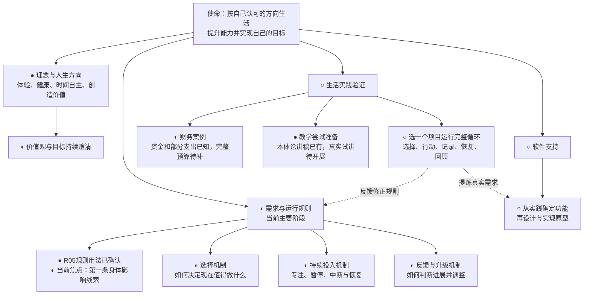
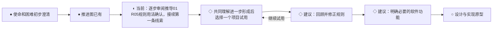

# 人生飞轮 · 项目推进图

更新时间：2026-10-28

当前定位：以智能为主要视角共同推导目标选择与实现。[逐步推导01](人生飞轮逐步推导-01.md)初稿已形成至R12，用户已确认R01、R02核心区分、R03可修订方向、R04评价本身接受评价，以及R05用规则引导具体审议的用法。用户补充AI辅助下用户作最终决定的意思，原句“排版”按语境暂解为“拍板”，已保留原句。**当前接续第一条具体线索：身体及长期行动能力的影响；四条具体标准仍待逐项确认。**v0.1保留为历史初稿，尚未形成v0.2，尚无软件原型或生活实践验证。

标记：● 已有初稿或初步明确，不代表定稿；◐ 进行中；○ 待开展；◇ 建议，尚未确认。

## 项目结构与当前位置

健康、学习、思考、注意力分配是用户提出的系统组成方向。具体模块边界和实施顺序尚未确定，上图不是最终软件架构。财务和教学是案例，并非两项必须同时推进的主项目。

## 推进路线

路线表达建议的依赖顺序，没有承诺日期。后续计划可根据用户选择和实践反馈调整。

## 节点状态与推进条件

| 节点 | 当前已有 | 下一步 | 可检查的推进结果 |
|---|---|---|---|
| 项目导航与架构（当前） | 原有文档与推导01；R01—R04局部确认及R05规则用法确认；保留用户关于AI辅助与用户最终决定的原句及释义 | 逐项讨论R05第一条身体及长期行动能力影响线索 | 用户能理解并检查模型的推导过程，区分确认内容与助手假设 |
| 理念与方向 | 使命、目前的人生观 | 在真实选择中继续澄清 | 能解释当前投入与认可生活的联系，无须最终定稿 |
| 选择机制 | 认可比较价值与保障基本条件；确认需要研究愿望或价值认同到投入目标的转化 | 共同推导目标评价与投入选择办法 | 面对具体时间能作出可解释的选择 |
| 持续投入 | 已明确中断、暂停与恢复需求 | 尝试最少的进度记录 | 下次能根据记录继续，不必从头回忆 |
| 反馈与升级 | 确认评估目标实现过程、判断困难并调整的职责 | 继续研究评估依据、方法与调整机制 | 能根据体验和结果作一次具体调整 |
| 财务案例 | 15万元；9月5121.10元，含拖车600元 | 补低频开销及待承担装修费用 | 得到有明确假设的预算和资金支撑期 |
| 教学案例 | 本体论原稿、修改稿、对比案例 | 如选为试点，向真实听众试讲并收反馈 | 留下理解效果及个人体验记录 |
| 生活实践验证 | 已有候选案例 | 选择一个载体，试运行循环 | 有行动、恢复及回顾的真实记录 |
| 软件支持 | 追踪进度、减少记忆负担的需求 | 根据实践确定最少必要功能 | 功能有实际使用证据支持，再进入实现 |

## 更新方式

每次推进后只更新相关节点的状态、成果及下一步，并移动“当前焦点”。仅完成讨论或写出草稿时，不标记为已经实践验证。图中的详细依据见[需求探索记录](需求探索记录.md)。

## 最近变更

- 2026-10-28（R05规则用法确认）：用户认可规则提供“大框架”，并补充AI辅助下用户作最终决定的意思（原句“排版”暂按“拍板”理解，保留纠正空间）。当前接续第一条身体影响线索，未自动确认四条具体标准，未新增实践验证结论。

- 2026-10-28（R04确认）：用户明确认可对欲望的评价本身也应接受评价。按此范围记录，未自动确认全部冲突处理程序；当前接续R05规则用法，四条具体线索尚待逐项审阅，未新增实践验证结论。

- 2026-10-27（R03确认）：用户认为评价依据是后天积累的，认可保留发展和修订空间。按用户观点与确认范围分别记录，未将其扩展为已核实的形成机制或完整操作程序；当前接续R04，未新增实践验证结论。

- 2026-10-27（R02确认）：用户认可并概括“目标有价值评价和事实评价”。记录为两类评价的核心区分，不等于已建立具体评价标准或完成状态模型；当前接续R03，未新增实践验证结论。

- 2026-10-27：用户要求逐项确认，通过澄清后明确认可R01核心区分：欲望是评价对象，认可属于赞同的价值评价，决定投入属于具体资源安排。当前接续R02，未将R01其他扩展或后续程序自动标记为确认，未新增实践验证结论。

- 2026-10-25（外出期间的推导记录）：按用户授权新增逐步推导01，分12小步展开愿望、认可、投入、实现条件、行动、恢复及评估与能力改善的联系。回查《机器人叛乱》部分原文，明确《生命3.0》及邦格材料缺口。全部新增推论待用户回来检查；阅读位置设为出发点及R01，不标记为已确认架构或实践成果。

- 2026-10-25（批注确认）：用户确认评估与调整职责，以及研究愿望或价值认同怎样成为决定投入目标的必要性。当前焦点移动到目标形成与投入选择；具体程序和机制尚未确定。

- 2026-10-25（进一步确认）：用户明确认可“实现目标”与“改善实现目标的能力”是飞轮的一部分；进一步区分为具体目标优化能力，以及因价值观认可能力改善本身而追求它。接续焦点推进到目标形成、选择与实现的联系；未将此前功能候选一并标记为已确认架构，未增加实践验证结论。

- 2026-10-25：用户反馈与v0.1的理解尚未融合，确认以智能为主要研究视角；飞轮包括目标挖掘、价值审议与选择，以及所选目标的实现，区分一般理论与个人实践。当前焦点改为共同推导主体模型与架构，详见需求记录最新接续摘要。《生命3.0》原书及相关能力边界主张、邦格模型原文尚待核对；新架构未定稿，未增加实践验证结论。

- 2026-10-24：按用户要求形成方法论与架构v0.1，包含系统职责、运行流程、规则索引、行动卡和理论缺口。初稿已产生，生活验证尚未开始；将当前焦点移动到初稿审阅。

- 2026-10-23：用户要求先解决项目架构与推进图。建立第一版导航；将当前焦点设为推进图，不直接启动生活试验或软件开发。后续路线是助手建议，尚待确认。
