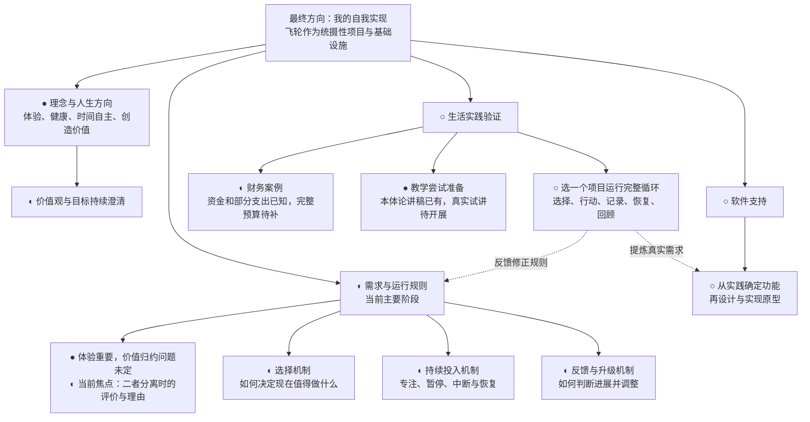

# 人生飞轮 · 项目推进图

更新时间：2026-10-30

当前定位：用户对“成就”偏向成就感、真实做成自己认可的事情还是两者的问题，明确回答“两者都有”。确认范围是两方面都包含在其成就关切中；尚未说明二者分离时如何评价，也未确认实际成就具有独立于体验的价值。下一步用具体例子了解：实际有进展但当时没有成就感时，用户是否仍认为值得，以及理由。尚无生活实践验证。

标记：● 已有初稿或初步明确，不代表定稿；◐ 进行中；○ 待开展；◇ 建议，尚未确认。

## 项目结构与当前位置

健康、学习、思考、注意力分配是用户提出的系统组成方向。具体模块边界和实施顺序尚未确定，上图不是最终软件架构。财务和教学是案例，并非两项必须同时推进的主项目。

## 推进路线

路线表达建议的依赖顺序，没有承诺日期。后续计划可根据用户选择和实践反馈调整。

## 节点状态与推进条件

| 节点 | 当前已有 | 下一步 | 可检查的推进结果 |
|---|---|---|---|
| 项目导航与架构（当前） | 用户明确体验重要且有价值，成就和助人也进入关切，是否可全归体验尚未确定 | 了解实际有进展但没有成就感时的评价及理由 | 记录准确反映用户当前认可及疑问，避免把归纳或理论标签当成用户结论 |
| 理念与方向 | 使命、目前的人生观 | 在真实选择中继续澄清 | 能解释当前投入与认可生活的联系，无须最终定稿 |
| 选择机制 | 认可比较价值与保障基本条件；确认需要研究愿望或价值认同到投入目标的转化 | 共同推导目标评价与投入选择办法 | 面对具体时间能作出可解释的选择 |
| 持续投入 | 已明确中断、暂停与恢复需求 | 尝试最少的进度记录 | 下次能根据记录继续，不必从头回忆 |
| 反馈与升级 | 确认评估目标实现过程、判断困难并调整的职责 | 继续研究评估依据、方法与调整机制 | 能根据体验和结果作一次具体调整 |
| 批判性思维能力 | 用户自述需要补充检查证据、条件、未知及AI分析的能力 | 后续澄清具体能力与练习、验证方式，不自动安排训练优先级 | 在具体判断中能说明事实支持与不确定性，实际效果待验证 |
| 财务案例 | 15万元；9月5121.10元，含拖车600元 | 补低频开销及待承担装修费用 | 得到有明确假设的预算和资金支撑期 |
| 教学案例 | 本体论原稿、修改稿、对比案例 | 如选为试点，向真实听众试讲并收反馈 | 留下理解效果及个人体验记录 |
| 生活实践验证 | 已有候选案例 | 选择一个载体，试运行循环 | 有行动、恢复及回顾的真实记录 |
| 软件支持 | 追踪进度、减少记忆负担的需求 | 根据实践确定最少必要功能 | 功能有实际使用证据支持，再进入实现 |

## 更新方式

每次推进后只更新相关节点的状态、成果及下一步，并移动“当前焦点”。仅完成讨论或写出草稿时，不标记为已经实践验证。图中的详细依据见[需求探索记录](需求探索记录.md)。

## 最近变更

- 2026-10-30（成就含义确认）：用户对“成就”偏向成就感、真实做成自己认可的事情还是两者的问题，明确回答“两者都有”。确认范围是两方面都包含在其成就关切中；尚未说明二者分离时如何评价，也未确认实际成就具有独立于体验的价值。下一步用具体例子了解：实际有进展但当时没有成就感时，用户是否仍认为值得，以及理由。

- 2026-10-28（体验表述核对）：用户基本认可体验重要及美食、电影、游戏的体验价值，提出成就与助人并不确定能否全归体验。记录为认可部分与未决问题，未判定唯一价值或独立价值。助手提出感受与实际结果的区分供梳理，下一步只澄清成就这一项，不把单次回答当作完整价值理论证明。

- 2026-10-28（三观梳理入口确认）：用户认可梳理已有理解作为一个入口，明确如何梳理缺少头绪、知识储备不足。将具体梳理和知识支持列为方法需求，先提取既有一句表述并核对当前认同；仅入口获确认，后续流程仍为草案，历史表述不自动成为当前价值公理。

- 2026-10-28（C01确认与主线纠正）：用户明确认可C01规则，澄清平行世界不是主要关心，自述当前世界观接近邦格、其他立场了解不多。停止沿例子继续追问，回到三观形成方法的入口与功能；不推定已接受邦格全部主张，具体方法及效果仍待研究和验证。

- 2026-10-28（三观与目标形成讨论）：用户提供思维导图，提出帮助形成世界观、价值观和人生观、从既有答案中选择，并以平行世界下体验是否仍有价值作思想实验。新增讨论记录，区分假设、体验归属与价值前提，提出三观与经历相互反馈及扩大入口等候选；未把宇宙论设想写成用户已采信事实，C01仍未确认，未新增实践验证。

- 2026-10-28（技术框架确认及方法构建）：用户逐项认可方法技术组合的目的性系统视角、功能与原理缺口、局部改进和分开研究的方向，同意先研究价值权衡。新增构建记录，整理功能草案并提出C01有条件比较规则；C01及具体规格尚待审阅，未解决全部价值冲突或完成实践验证。

- 2026-10-28（引入技术框架）：按用户指向读取《技术的本质》，主读第2、5、7章并回查第1、3、11章相关段落，新增T01—T09来源及飞轮启发笔记。发现“有目的的系统”与方法、流程、非物理手段的明确论述；提出把价值权衡等方法视为待构建技术的候选，未据此声称已解决价值权重、主体模型或完成实践验证。

- 2026-10-28（具体投入区分确认）：用户认可整体项目价值与下一次具体投入作用需要分开判断。只登记此区分，不视作完整权衡方法或具体排序确认；下一步需两项具体投入作推理材料，尚未启动生活试验。

- 2026-10-28（自我实现含义确认）：用户确认自我实现与“知道自己为什么而活，并按认可的方向生活，逐步成为自己满意的人”是一个意思。采用用户含义，不套用其他流派定义；当前拟区分整体项目价值与具体投入作用，具体方法仍待确认和验证。

- 2026-10-28（飞轮定位修正）：用户明确飞轮为重要项目和基础设施，所有项目最终为它服务，而它最终服务自己的自我实现。修正此前仅列局部作用、把它与本体论研究普通并列的窄化复述；原话与助手工作性解释分开，当前先澄清自我实现及目的关系，不自动推出投入顺序，完整价值权衡仍待补充。

- 2026-10-28（R06缺口确认）：用户明确确认缺少判断得失轻重的方法。回查《机器人叛乱》泰莎案例及既有S06、S09—S11，区分原书案例线索与助手提出的具体价值关切分析做法；尚无通用权重公式或完整取舍程序，不将需求确认写成方法认可，不推进R07。

- 2026-10-28（R06例子理解）：用户对例子中各安排得到和放弃什么表示“我能看清”。仅记录此理解进度，下一步拟澄清是否仍卡在不同得失如何比较轻重；不将其等同于完整取舍方法获确认，不推进R07。

- 2026-10-28（R06澄清）：用户明确表示不理解多个值得目标怎样决定投入，认为所列比较问题有帮助。助手承认此前列出的是比较线索，尚未提供完整取舍方法；记录具体假设例子供解释，停留R06，不将用户回应标记为整体确认或实践验证。

- 2026-10-28（R05第四条确认）：用户明确认可采用的观念和方法应允许合适的质疑、检查与修订，飞轮本身同样适用。规则用法和四个审议方向现均获认可，具体方法及有效性未验证；当前接续R06的具体投入比较。

- 2026-10-28（R05第三条确认）：用户认可将当前投入对未来目标和调整空间的影响列为审议依据，保留有理由作出承诺及承担部分限制的可能。未预设尽可能保留一切选择；当前接续第四条接受评估，未新增实践验证结论。

- 2026-10-28（R05第二条确认）：用户确认事实判断的可靠支持应列为审议依据，认可检查依据、适用条件和未知也适用于AI分析；自述需要补充相关批判性思维能力。此为需求与能力方向记录，未进行独立测评或安排训练；当前接续第三条未来空间，未新增实践验证结论。

- 2026-10-28（R05第一条确认）：用户认可把目标对身体及长期行动能力的影响作为重要审议依据，与其他价值一起权衡，接受代价时检查理由和边界。未预设固定的最高价值或具体健康方案；当前接续第二条信念依据，未新增实践验证结论。

- 2026-10-28（R05规则用法确认）：用户认可规则提供“大框架”，并补充AI辅助下用户作最终决定的意思（原句“排版”暂按“拍板”理解，保留纠正空间）。当前接续第一条身体影响线索，未自动确认四条具体标准，未新增实践验证结论。

- 2026-10-28（R04确认）：用户明确认可对欲望的评价本身也应接受评价。按此范围记录，未自动确认全部冲突处理程序；当前接续R05规则用法，四条具体线索尚待逐项审阅，未新增实践验证结论。

- 2026-10-27（R03确认）：用户认为评价依据是后天积累的，认可保留发展和修订空间。按用户观点与确认范围分别记录，未将其扩展为已核实的形成机制或完整操作程序；当前接续R04，未新增实践验证结论。

- 2026-10-27（R02确认）：用户认可并概括“目标有价值评价和事实评价”。记录为两类评价的核心区分，不等于已建立具体评价标准或完成状态模型；当前接续R03，未新增实践验证结论。

- 2026-10-27：用户要求逐项确认，通过澄清后明确认可R01核心区分：欲望是评价对象，认可属于赞同的价值评价，决定投入属于具体资源安排。当前接续R02，未将R01其他扩展或后续程序自动标记为确认，未新增实践验证结论。

- 2026-10-25（外出期间的推导记录）：按用户授权新增逐步推导01，分12小步展开愿望、认可、投入、实现条件、行动、恢复及评估与能力改善的联系。回查《机器人叛乱》部分原文，明确《生命3.0》及邦格材料缺口。全部新增推论待用户回来检查；阅读位置设为出发点及R01，不标记为已确认架构或实践成果。

- 2026-10-25（批注确认）：用户确认评估与调整职责，以及研究愿望或价值认同怎样成为决定投入目标的必要性。当前焦点移动到目标形成与投入选择；具体程序和机制尚未确定。

- 2026-10-25（进一步确认）：用户明确认可“实现目标”与“改善实现目标的能力”是飞轮的一部分；进一步区分为具体目标优化能力，以及因价值观认可能力改善本身而追求它。接续焦点推进到目标形成、选择与实现的联系；未将此前功能候选一并标记为已确认架构，未增加实践验证结论。

- 2026-10-25：用户反馈与v0.1的理解尚未融合，确认以智能为主要研究视角；飞轮包括目标挖掘、价值审议与选择，以及所选目标的实现，区分一般理论与个人实践。当前焦点改为共同推导主体模型与架构，详见需求记录最新接续摘要。《生命3.0》原书及相关能力边界主张、邦格模型原文尚待核对；新架构未定稿，未增加实践验证结论。

- 2026-10-24：按用户要求形成方法论与架构v0.1，包含系统职责、运行流程、规则索引、行动卡和理论缺口。初稿已产生，生活验证尚未开始；将当前焦点移动到初稿审阅。

- 2026-10-23：用户要求先解决项目架构与推进图。建立第一版导航；将当前焦点设为推进图，不直接启动生活试验或软件开发。后续路线是助手建议，尚待确认。
